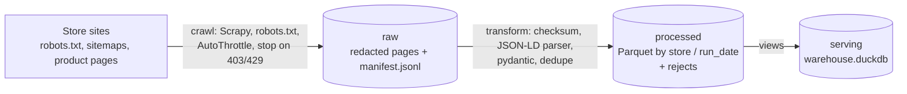

# ecommerce-scraping

> A polite Scrapy crawler for three Brazilian fashion stores, built as a layered ingestion
> pipeline: redacted raw pages, validated Parquet partitioned by store and date, DuckDB views
> on top.

[](https://github.com/emanuel-luis/ecommerce-scraping/actions/workflows/ci.yml)


The crawler reads product data from Hering, Levi's Brasil and TNG. All three publish product
sitemaps and embed schema.org `Product` data (name, SKU, price, availability) as JSON-LD in
their server-rendered pages, so the pipeline needs no browser and no CSS selectors. Each run
is small by default (20 products per store) and goes one request at a time per site.

## What this demonstrates

- Layered ingestion: raw pages with a manifest (URL, status, UTC fetch time, SHA-256), a
  processed layer of validated Parquet partitioned by `store` and `run_date`, and DuckDB views
  as the serving layer.
- Idempotent, re-runnable steps: a raw run is never overwritten, the transform is the only
  parse path and rewrites the same files when run again, and the views are recreated from the
  files.
- Data contracts and quality checks at each boundary: pydantic models, checksum verification,
  rejects stored with their stage and reason, deduplication by product key, and a per-store
  reconciliation of the raw manifest against the crawl's page count.
- Run metadata: `run_id`, UTC timestamps, pages archived, robots.txt refusals, HTTP errors,
  retries, rows out, rejects and duplicates per store, queryable in the `runs` view.
- Responsible crawling: robots.txt obeyed, an identifying User-Agent, AutoThrottle, a stop on
  403 or 429, and personal data (customer reviews) removed before anything is written.
- Offline tests on saved pages, including an end-to-end crawl against local fixture servers,
  with an 85 % coverage gate, mypy strict, CI and a Docker image.

## Architecture



| Layer | Location | Written by | Contents |
| --- | --- | --- | --- |
| raw | `data/raw/<run_id>/<store>/` | `crawl` | one gzip page per product URL, `manifest.jsonl`; `data/raw/<run_id>/run.json` once the crawl ends |
| processed | `data/processed/products/store=<s>/run_date=<d>/<run_id>.parquet` | `transform` | rows that passed the contract; rejects under `processed/rejects/` with the same layout; `processed/_runs/<run_id>.json` written last |
| serving | `data/warehouse.duckdb` | `views` | views `runs`, `product_snapshots`, `products_latest`, `price_history`, `rejects` |

`run_id` is the UTC start time of the crawl (`20261026T141502Z`), so runs sort in time order
and a run always lands in one `run_date` partition.

The raw layer keeps a redacted page, not the full HTML: the canonical link and the JSON-LD
`Product` nodes, with reviews, authors and any person node removed. That is all the
transform reads, and it keeps out the customer names some stores put in their reviews.

## Crawling politely

- `robots.txt` is obeyed. The crawl starts from the sitemap each store publishes and only
  fetches product pages (`/<slug>/p`); search and filter URLs are never requested.
- The User-Agent names the project and links to this repository.
- One request at a time per store, 3 seconds apart, with AutoThrottle slowing down when the
  site responds slowly.
- A 403 or 429 (robots.txt included) stops that store's crawl for the run. 429 is not retried.
- Runs are capped: 20 product pages per store by default, 5 in `make demo`, 10 in Docker
  Compose. A full catalog crawl needs an explicit `--no-limit`.
  Even then each store stops after one hour (about 1,200 pages); the run ends `partial` with the finish reason `closespider_timeout`.

The 2022 version crawled eleven stores. A check of each site's robots.txt and current pages in
October 2026 kept three; [docs/DECISIONS.md](docs/DECISIONS.md) records why each of the
others was dropped.

## Tech stack

Python 3.12 · Scrapy · parsel · pydantic · DuckDB · Parquet · Typer · uv · ruff · mypy ·
pytest · hypothesis · Docker · GitHub Actions

## Quickstart

Needs [uv](https://docs.astral.sh/uv/) and make. This crawls the live stores (5 products each)
and takes about a minute.

```bash
git clone https://github.com/emanuel-luis/ecommerce-scraping && cd ecommerce-scraping
make demo
```

Without make:

```bash
uv sync --locked
uv run ecommerce-scraping run --limit 5
uv run ecommerce-scraping stats
```

With Docker Compose (10 products per store, data in the named volume `data`):

```bash
docker compose up --build    # crawler runs, then the stats service prints the counts
docker compose down -v       # removes the containers and the volume
```

To query the result:

```bash
uv run python -X utf8 -c "import duckdb; print(duckdb.connect('data/warehouse.duckdb', read_only=True).sql('SELECT store, name, price, in_stock FROM products_latest'))"
```

## CLI

| Command | What it does |
| --- | --- |
| `ecommerce-scraping crawl [--store NAME]... [--limit N \| --no-limit] [--run-id ID]` | crawl into a new raw run and print its `run_id` (default: every store, 20 products each) |
| `ecommerce-scraping transform [--run-id ID]` | raw → processed (default: the latest finished crawl) |
| `ecommerce-scraping views` | (re)create the DuckDB views over the processed files |
| `ecommerce-scraping run [--store NAME]... [--limit N \| --no-limit]` | crawl → transform → views |
| `ecommerce-scraping stats` | per store: runs, snapshots, products, rejects, last run |

Store names: `hering`, `levi`, `tng`. A step exits with code 1 when it fails, or when a run
yields no rows at all. A run where some store yields nothing (for example a store that answered
403) is `partial`: it is logged and exits 0. Logs go to stderr with UTC timestamps, the
`run_id` and the step.

## Data contracts and quality checks

| Boundary | Check | On failure |
| --- | --- | --- |
| site → raw | robots.txt allows the URL | not requested, counted as `robots_forbidden` |
| site → raw | HTTP status; retries on 5xx and timeouts | 4xx not archived, counted as `http_errors`; 403 / 429 stop the store |
| raw → processed | `run.json` exists (the crawl finished) | the step fails |
| raw → processed | file SHA-256 equals the manifest's | reject, stage `parse` |
| raw → processed | page has a JSON-LD `Product` with a price | reject, stage `parse` |
| raw → processed | `ProductSnapshot` contract: name present, price ≥ 0 with 2 decimals, high price ≥ price, ISO currency, schema.org availability | reject, stage `validate` |
| raw → processed | one row per product key (the lowercased URL path) per store and run | reject, stage `duplicate` |
| raw → processed | manifest lines = pages archived by the crawl, per store; every page becomes a row, a reject or a duplicate | the step fails |

Prices are stored as published, in BRL. When a product has several variants, `price` is the
lowest offer and `high_price` the highest; `in_stock` is true when any variant is in stock.

## Serving layer

| View | Grain | Contents |
| --- | --- | --- |
| `runs` | run × store | status, finish reason, pages, robots refusals, HTTP errors, retries, rows, rejects, duplicates, UTC start and finish |
| `product_snapshots` | run × store × product | every validated row, with `store` and `run_date` from the partition path |
| `products_latest` | store × product | the most recent snapshot of each product |
| `price_history` | run × store × product | price, stock and `price_change` against the previous snapshot |
| `rejects` | run × store × page | stage and reason of every page that did not become a row |

`runs` lists every transformed run, failed ones included; the other views only show runs with status ok or partial. Timestamps are UTC.

## Configuration

Every setting is optional and none is a secret. Copy `.env.example` to `.env` to override.

| Variable | Default | Purpose |
| --- | --- | --- |
| `ECOMMERCE_DATA_DIR` | `data` | root of the three layers (`/data` in the image) |
| `ECOMMERCE_USER_AGENT` | `ecommerce-scraping/<version> (+repo URL)` | sent with every request |
| `ECOMMERCE_DOWNLOAD_DELAY_S` | `3` | seconds between requests to the same store; under 2 is refused unless every target is loopback |
| `ECOMMERCE_DEFAULT_LIMIT` | `20` | product pages per store when `--limit` is not given |
| `ECOMMERCE_STORE_BASE_URLS` | `{}` | JSON map replacing a store's base URL; the end-to-end test points it at local servers |
| `ECOMMERCE_LOG_LEVEL` | `INFO` | log level |

## Development

```bash
make install       # uv sync --locked
make lint          # ruff check, ruff format --check, mypy (what CI runs)
make test          # offline tests with the 85 % coverage gate
make help          # every target
```

Tests never touch the stores. Parser tests use pages saved once and redacted (see
[tests/fixtures/README.md](tests/fixtures/README.md)), and the end-to-end test runs a real
crawl in a subprocess against local HTTP servers that serve a fixture site: robots.txt, a
sitemap index, product sitemaps, a redirect, a 404, a page without JSON-LD, a duplicate and a
store that answers 403.

## Project structure

```
src/ecommerce_scraping/
  cli.py              Typer commands
  config.py           settings from ECOMMERCE_* env vars
  stores.py           the store registry (name, base URL)
  spider.py           sitemap spider: product sitemaps -> product pages -> RawPage items
  middlewares.py      stops a store's crawl on 403 / 429
  pipelines.py        raw layer writer (gzip + manifest)
  scrapy_settings.py  robots.txt, delays, AutoThrottle, retries
  crawl.py            one Scrapy process for the selected stores, run.json
  jsonld.py           redaction and the JSON-LD Product parser (pure functions)
  transform.py        raw -> processed: checksums, contracts, dedupe, Parquet
  warehouse.py        DuckDB views and stats
  models.py           pydantic contracts; schema.py: Parquet columns
  runs.py             run ids, layer paths, step logger
tests/                offline tests; fixtures/ holds redacted pages and the fixture site
docs/                 decisions log and refactor plan
```

## History

The 2022 version ran eleven spiders through Splash and Selenium with XPath selectors on CSS
classes and wrote CSV and JSON files. Its selectors no longer matched, several of its listing
URLs are now disallowed by the sites' robots.txt, and it ignored robots.txt. The 2026 rewrite
replaced it with the pipeline above; [docs/REFACTOR_PLAN.md](docs/REFACTOR_PLAN.md) has the
design and [docs/DECISIONS.md](docs/DECISIONS.md) the reasons.

## License

[MIT](LICENSE)
